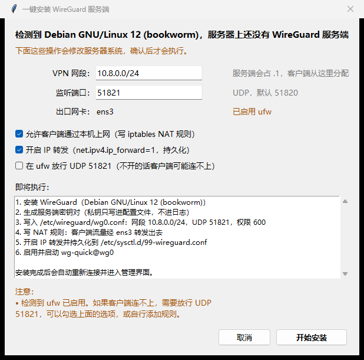

# WireGuard 管理台

一个 Windows 桌面工具，两件事合在一个程序里：**本机组网**（导入 conf、连接 / 断开隧道，不用另开 WireGuard 客户端）和**服务器密钥管理**（SSH 连上去可视化查看 / 新增 / 修改 / 删除客户端密钥，不用手敲 `wg`、`wg-quick`，也不用登上去编辑 `wg0.conf`）。


[](https://github.com/leirui2/wireguard-manage/actions/workflows/build.yml)

### ⬇️ 直接下载

| 版本 | 下载 | 说明 |
|---|---|---|
| **最新构建** | **[WireGuardManager.exe](https://github.com/leirui2/wireguard-manage/releases/latest/download/WireGuardManager.exe)** | 每次推送到 `main` 自动重新打包，链接永久不变 |

SHA256 校验值见同一发行版下的 [SHA256.txt](https://github.com/leirui2/wireguard-manage/releases/latest/download/SHA256.txt)。

> Windows 10 / 11 64 位，双击即用，**不需要安装 Python 或任何运行库**。
> 也可以到 [Releases 页面](https://github.com/leirui2/wireguard-manage/releases) 查看历史版本。

---

## 功能特性

| 功能 | 说明 |
|---|---|
| **查看密钥** | 自动列出所有 `[Peer]`，显示备注名、公钥、VPN 地址、最近握手、上下行流量、来源端点、在线状态 |
| **新增密钥** | 自动分配空闲 IPv4/IPv6 地址 → 生成密钥对 → 写入 `[Peer]` → 热加载 → 生成客户端 `.conf` |
| **扫码导入** | 生成密钥后一键出二维码，手机 WireGuard App 直接扫，也可存成 PNG |
| **客户端下载** | 内置 Windows / Android / iOS / macOS / Linux 官方下载入口，只收官方来源 |
| **修改密钥** | 改名称 / 备注 / VPN 地址。改名只动注释、不影响隧道；改地址后自动检查冲突并提示同步客户端 |
| **删除密钥** | 多选后二次确认，同时从配置和运行时移除 |
| **备注管理** | 名称/备注以注释形式存在 `[Peer]` 上方，换设备、换工具都不会丢 |
| **自动探测部署** | 自动找 `wg`、`/etc/wireguard/*.conf`、活动接口、服务端公钥、监听端口、允许网段、DNS |
| **一键装服务端** | 服务器还没装 WireGuard？弹窗确认后自动装包、建配置、开转发、起服务，装完直接可用 |
| **密码 / 私钥双认证** | 支持 SSH 密码，也支持 OpenSSH / PEM 私钥（可带口令）；sudo 密码可单独填 |
| **多服务器** | 记住连接过的服务器（**只存主机/端口/用户名/私钥路径，不存任何密码**） |
| **本机组网** | 独立页面管理本机隧道：导入 conf、连接 / 断开、看状态和**实时速率曲线**，**不需要连服务器**。管理服务器时在连接区选一条隧道，连接前自动拉起；有公网就选「直连」 |
| **检查更新** | 底部一键检查新版，下载后校验 SHA256 再自我替换并重启，不用手动下载覆盖 |

### 兼容性

- **标准 `wg-quick` 部署**：完全支持（包括 `angristan/wireguard-install` 这类一键脚本，它最终也是标准 `wg0.conf`）
- **Docker / wg-easy**：会尝试 `docker exec` 进容器读写；但 wg-easy 新版本可能改用数据库管理客户端，直接改文件未必生效，**请先在测试环境验证**
- **配置路径不在默认位置**：可在「高级设置」里手动指定配置文件绝对路径和接口名

---

## 快速开始

### 方式一：直接用（推荐给最终用户）

发行版只有两种，**功能完全相同**，按使用习惯选：

| 下载 | 启动到能操作 | 说明 |
|---|---|---|
| [WireGuardManager-setup.exe](https://github.com/leirui2/wireguard-manage/releases/latest/download/WireGuardManager-setup.exe) | **约 1 秒** | **安装版**：双击安装，开始菜单 + 桌面快捷方式，卸载在「应用和功能」里；可选同时装官方 WireGuard 客户端 |
| [WireGuardManager.exe](https://github.com/leirui2/wireguard-manage/releases/latest/download/WireGuardManager.exe) | 约 5 秒（第 0.6 秒先弹启动图） | 单文件，免安装，**支持程序内自动更新** |

单文件版慢的原因不是代码：它每次启动都要把 **49 MB / 1028 个文件**解到
`%TEMP%\_MEIxxxx`，实测解压占 2.4 秒，再加上冻结后加载 DLL、杀软扫描，合计约 5 秒。
安装版把这些文件摊在 `_internal\` 里，直接加载，实测 0.9 秒 —— 这是安装版快的原因。

**安装版怎么装**

1. 双击 `WireGuardManager-setup.exe`
2. 默认装到 `%LOCALAPPDATA%\Programs\WireGuard 管理台`，**安装位置可以自己改**
3. 默认**只给当前用户装，全程不弹 UAC**；要给全机装就显式加 `/ALLUSERS`：
   `WireGuardManager-setup.exe /ALLUSERS /VERYSILENT`
4. 卸载：安装目录里的「卸载 WireGuard 管理台」、开始菜单同名项，或系统「应用和功能」

装到 `C:\Program Files` 也能用 —— 程序发现安装目录不可写时，会把配置自动放到
`%LOCALAPPDATA%\WireGuard管理台`，并把旧配置搬过去一次。**两种形态共用同一套配置文件**，
互相切换时配置能跟着走。

> 安装包未做代码签名，SmartScreen 可能提示"未知发布者"，选「更多信息 → 仍要运行」。

**单文件版怎么用**

1. 下载 `WireGuardManager.exe`
2. 放到**有写权限的目录**（桌面、D 盘、U 盘都行，**不要放 `C:\Program Files`**）
3. 双击运行

目标电脑**不需要安装 Python 或任何依赖**，已自带解释器、Tcl/Tk、OpenSSL 和 SSH 库。

> 仅支持 64 位 Windows 10 / 11。

### 方式二：源码运行（开发/调试）

需要 **Python 3.10+，且自带 tkinter**（Windows 官方安装包默认包含）。

```bat
双击 启动工具.bat
```

首次运行会自动把 `paramiko` 装到项目内的 `vendor\` 目录（需联网），不污染系统 Python。

也可以手动执行：

```bat
python -m pip install --target vendor paramiko==5.1.0
set PYTHONPATH=%CD%;%CD%\vendor
python main.py
```

### 方式三：自己打包 exe

```bat
双击 打包exe.bat
```

约 3 分钟，一次出两个产物：

| 产物 | 说明 |
|---|---|
| `dist\WireGuard管理台.exe` | 单文件版，带启动画面（`build_assets/splash.png`） |
| `dist\WireGuard管理台-安装包-<版本>.exe` | 安装包（Inno Setup），装完启动 1 秒 |

流程是：写版本号 → 生成启动图（图里印着版本，所以必须在写版本之后）→
单文件（`wireguard-manager.spec`）→ 目录版布局（`wireguard-manager-onedir.spec`，
输出到 `build\installer-src\`，**只做安装包原料，不对外发布**）→
`build_assets\make_installer.py` 编译安装包。

安装包那一步需要 **Inno Setup 6**，没有就自动跳过（`winget install JRSoftware.InnoSetup`）。
想让它带「同时安装 WireGuard 官方客户端」的勾选项，把
`wireguard-amd64-<版本>.msi` 放进 `build_assets\` 即可 —— 会先校验 SHA256 与 Authenticode 签名，
签发给 WireGuard LLC 才打进去。国内网络下官网常被 DNS 污染 / 直连被重置，
`build_assets\fetch_wireguard_msi.py` 会自动依次试环境变量代理、系统代理、直连。

打包环境是项目内的 `.build-venv\`，首次使用需先创建：

```bat
python -m venv .build-venv
.build-venv\Scripts\python.exe -m pip install pyinstaller==6.22.3 paramiko==5.1.0
```

---

## 服务器上没有 WireGuard？一键安装

连上去发现服务器是个「裸机」时，工具不会只丢一句"没找到配置文件"，而是弹出安装方案：



> 上图是真实的对话框（Debian 12 环境）。下面以 Ubuntu 为例展示同样的内容：

```
检测到 Ubuntu 22.04.4 LTS，服务器上还没有 WireGuard 服务端

VPN 网段：  [10.9.0.0/24]    服务端会占 .1，客户端从这里分配
监听端口：  [51821]          UDP，默认 51820
出口网卡：  eth0

☑ 允许客户端通过本机上网（写 iptables NAT 规则）
☑ 开启 IP 转发（net.ipv4.ip_forward=1，持久化）
☐ 在 ufw 放行 UDP 51821

即将执行：
1. 安装 WireGuard（Ubuntu 22.04.4 LTS）
2. 生成服务端密钥对（私钥只写进配置文件，不进日志）
3. 写入 /etc/wireguard/wg0.conf：网段 10.9.0.0/24，UDP 51821，权限 600
4. 写 NAT 规则：客户端流量经 eth0 转发出去
5. 开启 IP 转发并持久化到 /etc/sysctl.d/99-wireguard.conf
6. 启用并启动 wg-quick@wg0
```

点「开始安装」之后才会真正执行，装完**自动重新探测并进入管理界面**，不用重连。

### 它会做什么

| 步骤 | 说明 |
|---|---|
| 装包 | 按发行版和版本选命令：`apt` / `dnf·yum` / `pacman` / `zypper`，命令对过官方文档 |
| 验模块 | `modprobe wireguard`，内核没有模块就当场停手，不写配置 |
| 选参数 | 自动挑一个**没被占用**的网段和 UDP 端口，撞车就顺延；也可手动改 |
| 生成密钥 | `wg genkey`，私钥只写进配置文件（600），**不进命令行也不进日志** |
| 写配置 | 标准 `wg-quick` 格式；NAT 按探测结果选 iptables / firewalld / 不写 |
| 开转发 | 写 `/etc/sysctl.d/99-wireguard.conf`，重启后依然生效 |
| 起服务 | `systemctl enable` + `restart`，然后回读公钥校验 |

### 它不会做什么

- **不覆盖任何已存在的配置文件**——发现 `wg0.conf` 已存在直接中止，把决定权交回给你
- **不主动改防火墙**——只在你勾选时才放行端口
- **不动已有网络配置**——只新增一条私网路由和一个 NAT 规则（后者由 wg-quick 自己回收）
- **不支持时明确说不**——发行版识别不出来就直说，不会瞎试

### 支持哪些系统

下表的命令逐条对过官方文档（WireGuard 官网 Installation 页、Red Hat 文档、各发行版仓库元数据）：

| 系统 | 装包命令 | 说明 |
|---|---|---|
| Ubuntu 20.04+ / Debian 11+ / Mint 21+ / Kali / Deepin / UOS / Armbian / 树莓派 OS | `apt-get install wireguard` | 内核 5.10+ 自带模块，开箱可用 |
| RHEL 9 / Rocky 9 / Alma 9 / CentOS Stream 9·10 / Fedora | `dnf install wireguard-tools` | 包在官方 **AppStream** 仓库，内核 5.14 自带模块，**不需要 EPEL** |
| RHEL / Rocky / Alma / CentOS 8 | 先装 EPEL + ELRepo，再装 `kmod-wireguard` + `wireguard-tools` | 内核 4.18 没有模块，`wireguard-tools` 也只在 EPEL |
| Arch / Manjaro / EndeavourOS | `pacman -S --needed wireguard-tools` | **不做部分升级**：`pacman -Sy` 会升坏 glibc/sudo，官方明令禁止 |
| openSUSE Leap / SLES | `zypper install wireguard-tools` | 在 main/oss 仓库 |
| Debian 10 及更早、Ubuntu 18.04 | — | **明确拒绝**：包在 backports / 内核 4.15 没模块，自动装必然失败在半路 |
| CentOS 7 / RHEL 7 | — | **明确拒绝**：已 EOL，软件源多已下线，内核 3.10 还要 ELRepo |
| Alpine / Devuan / Gentoo / Void（非 systemd） | — | **明确拒绝**：起不了服务，宁可不装也不留半成品 |
| 其它 / 识别不出来 | — | 明确拒绝，并逐条给出手动命令 |

判据是 `/etc/os-release` 里的 `ID`、`ID_LIKE`、`VERSION_ID`，不靠猜发行版名字。
另外会检查 `/proc/1/comm` 确认 systemd 真的是 PID 1 —— 容器里 `systemctl` 可能装了但用不了，也会被拦下。

**装完还会验一次内核模块**：`modprobe wireguard` 失败就立刻停手，不写配置、不启动服务。
这一步比猜版本号可靠 —— 有人把 Debian 10 的内核升到 5.10，照样能直接装。

### NAT 怎么配

不同系统上"能不能写 `iptables`"差别很大，写错会让 `wg-quick up` 直接失败（PostUp 任一命令返回非 0 就中止）：

| 探测结果 | NAT 怎么处理 |
|---|---|
| firewalld 在运行 | 用 `firewall-cmd --permanent --add-masquerade`，**不碰 iptables**（Red Hat 要求两者只用一个） |
| 有 `iptables` 命令 | 写进配置的 `PostUp` / `PostDown`，随接口启停自动回收规则 |
| 两者都没有 | **不写 PostUp**，配置里注明原因，并提示需要自己配 masquerade |

> RHEL 9 / 树莓派 OS Lite 这类精简系统默认没有 `iptables` 命令，硬写 PostUp 会让接口起不来 —— 所以是探测后再决定，不是固定写死。

### 前提条件

1. 有 **root 或可用的 sudo**（跟读配置的要求一样）
2. 服务器能装上包（要能访问软件源）
3. **云厂商安全组要另外放行 UDP 端口**——这个工具改不到你的云控制台

> 支持矩阵里的命令是按官方文档核对的，除 Ubuntu 22.04 外**没有在真机上装过**。
> 第一次在某个发行版上使用时，建议先在测试机跑一遍，把「即将执行」和报错日志留下来。

---

## 使用说明

### 1. 连接

| 字段 | 说明 |
|---|---|
| 服务器 IP | 公网或内网地址都行。填内网地址时，工具会自动把客户端 `Endpoint` 换成服务器公网 IP |
| SSH 端口 | 默认 22，改过就填实际端口 |
| 用户名 | 推荐 `root`；普通账号需要 sudo 权限（见下） |
| 认证方式 | 密码 或 私钥文件 |
| 私钥口令 | 私钥没加密就留空 |
| **sudo 密码** | **非 root 账号必填**。密码登录时可留空（默认复用 SSH 密码）；私钥登录时一定要单独填 |

点「连接」后，工具会自动探测并显示：接口名、配置文件路径、监听端口、VPN 网段、DNS、服务端公钥。

> 读取 `/etc/wireguard/wg0.conf` 通常需要 root（该目录一般是 `700`）。
> 普通账号要么在连接区填 **sudo 密码**，要么让管理员配置免密 sudo（`NOPASSWD`）。

#### 组网隧道：可以单独用，也可以给连接用

界面分成两个页面，互不依赖：

| 页面 | 干什么 | 需要服务器 |
|---|---|---|
| **本机组网** | 导入 conf、连接 / 断开隧道、看状态和实时速率 —— 就是个纯 VPN 开关 | 不需要 |
| **密钥管理** | 连服务器、增删改密钥 | 需要（有公网就直连） |

**只想挂 VPN** → 在「本机组网」页导入 `.conf`，双击那条隧道就连上了，跟服务器一点关系都没有。

**要管理内网里的服务器** → 先把 conf 导进「本机组网」页，再到「密钥管理」页的「组网隧道」下拉里选它，服务器 IP 填**这台服务器的 VPN 地址**（如 `10.18.0.1`）。点「连接」时会先确保隧道起来，等到端口真通了才建 SSH。

**服务器有公网** → 下拉选「直连（不组网）」，跟以前一样。

组网页下半部分是**选中隧道的详情**：本机地址、对端 Endpoint、允许的 IP、最近握手、监听端口、服务器公钥、预共享密钥、保活间隔、累计流量，右边是**最近 60 秒的实时速率曲线**（接收绿、发送橙）。

速率的取数方式是**只读本机网卡计数**（`GetIfTable2` 读隧道虚拟网卡，每秒一次，约 1.7 ms，不需要管理员权限）：

- 隧道没在跑就是 `—`，不会有残留数字
- 只在这个页面显示时才采样 —— 切到「密钥管理」页或缩到托盘就停，不白烧 CPU
- 「最近握手」来自 `wg show`，需要能访问隧道命名管道；读不到会显示「读不到（wg 权限不足或隧道刚启动）」，不影响速率显示
- 当前会话的曲线只存在内存里，关掉程序就清空（历史流量请看管理页的「流量」按密钥统计）

隧道交给官方客户端托管（`wireguard.exe /installtunnelservice`），**流量不经过本工具**。
连接和断开都会弹**一次 Windows 权限确认（UAC）**，必须点「是」。

其他细节：

- **隧道已经在跑**（包括你在客户端里手动连的那条）→ 直接复用，不重复安装
- **目标地址本来就通**（走公网可达）→ 跳过组网，少弹一次 UAC
- **退出默认不断开**隧道（别的程序可能还在用）。可在「设置」里改成退出时断开
- **客户端里建的隧道**（如 `18-rl`）也会列在组网页，但配置被客户端加密保存，本工具只能看状态和断开，**连接不了** —— 想在这里一键连就导入对应的 `.conf`
- **导入的 `.conf` 含私钥**，用 Windows DPAPI 加密后存进 `tunnels.json`，不明文落盘
- 临时明文 conf 只在 `%TEMP%\wgm-tunnel-*` 待几秒，隧道确认起来后立刻删除，异常退出留下的下次启动清理

#### 开机自动连隧道

「设置」→ 勾上「开机自动启动」→ 在「开机后自动连接」里选一条隧道（默认是「不组网（只开程序）」）：

- 登录 Windows 后程序自动打开，并把选中的那条隧道连上；选「不组网」就只开程序、不碰网络
- **只认系统登录拉起的那一次**：注册表里的启动命令后面带 `--boot`，手动双击打开不会自动连、也不会突然弹 UAC（老版本写进去的纯路径会在升级后首次启动时自动补上）
- 隧道要靠管理员权限建立，**登录后会弹一次 UAC，请点「是」**；不点就连不上（Windows 服务安装的限制，绕不过去）
- 隧道已经在跑（上次没断开，或在官方客户端里连着）→ 直接复用，不会再弹 UAC
- 选中的隧道后来被删掉了 → 开机时跳过并记一行日志；「设置」里那条会标红，重新选一条即可
- 下拉只列本工具导入的隧道 —— 客户端自己建的那些拿不到配置，起不了

### 2. 查看

列表默认显示名称、备注、公钥前缀、VPN 地址、最近握手、流量、来源端点、在线状态。
**5 分钟内有握手即视为在线**。双击某一行可以看完整公钥。

### 3. 新增密钥

点「＋ 新增密钥」，填写：

- **密钥名称**（必填，例如 `张三-手机`）
- 备注（选填，例如 `研发部 / 2026年入职领用`）
- 客户端 `AllowedIPs`（默认 `0.0.0.0/0, ::/0`，即全局代理）
- DNS（默认取自服务端配置）
- Endpoint（默认 SSH 的 IP + 监听端口）
- 指定 VPN 地址（留空 = 自动分配）
- 是否使用 `PresharedKey`（默认跟随现有密钥的惯例）

生成后会弹出客户端 `.conf` 全文，可复制或另存，并默认保存到 `clients\` 目录。

这个窗口里还有个 **「生成二维码」** 按钮：点一下就把整份配置渲染成二维码，手机 WireGuard App
选「从二维码导入 / 扫描二维码」扫一下就能连上，不用手抄私钥。二维码窗口还能「保存为 PNG」。

> ⚠️ **客户端私钥只会出现这一次**。服务端只保存公钥，之后无法重新导出，请务必保存 `.conf`。
> 二维码里含私钥，扫完别截图外传。

### 4. 修改密钥

选中一行 →「编辑选中」，可以改三样：

| 字段 | 影响 |
|---|---|
| 名称 | 只改 `[Peer]` 上方的注释，**对已连接的隧道没有任何影响**，改完立刻生效 |
| 备注 | 同上 |
| VPN 地址 | 改服务端分配的 `AllowedIPs`。**该客户端会立刻断线**，必须把它的配置里 `Address` 改成同样的值才能重连 |

改地址时会做检查：已经被别的密钥占用、或填了服务器自己的地址，会直接拒绝；填单个 IP 漏了 `/32` 会自动补全；地址不在 VPN 网段内会给出警告。

如果本机 `clients\` 目录里正好有该客户端导出的 `.conf`，工具会问你要不要顺手把里面的 `Address` 行改掉。

> 公钥和 `PresharedKey` 不能编辑——前者是身份，后者一改就等于重发密钥，真要换只能删掉重建。

### 5. 删除密钥

选中一行或多行（`Ctrl` / `Shift` 多选）→「删除选中」→ 二次确认。

### 6. 高级设置

探测不准时（例如配置不在 `/etc/wireguard`），手动指定：

- 配置文件绝对路径
- 接口名（如 `wg0`）
- 客户端 Endpoint 主机（当 SSH 地址与 VPN 入口地址不同时）

### 7. 界面设置

「设置」里除了托盘、开机自启（含**开机自动连隧道**）、刷新间隔，还有**界面字号**：

| 档位 | 基准字号 | 相当于 |
|---|---|---|
| 小 | 9 | 笔记本小屏、想多放几行 |
| 标准 | 10 | 默认 |
| 大 | 11 | 高分屏、看着吃力 |
| 特大 | 12 | 老花眼 / 远距离看 |

选中即时生效，写进 `settings.json`（`ui_font_size`），下次启动沿用。

几点说明：

- **只影响界面显示**，不改任何配置内容，也不会写进服务器
- 表格行高、列宽、图表坐标轴一起缩放，不会出现「字大了但列宽没变、数字被截断」
- 窗口高度上限是屏幕的 90%，字号调大后会自动少显示两行日志 —— 宁可日志短一点，也不让底部按钮被切掉
- 图标、二维码图片不跟着缩放

### 8. 下载客户端

顶部「下载客户端」按钮里放了各平台的**官方**下载地址（只收官方来源）：

| 平台 | 地址 | 备注 |
|---|---|---|
| Windows | [wireguard-installer.exe](https://download.wireguard.com/windows-client/wireguard-installer.exe) | 自动选 64/ARM 架构，装完双击 `.conf` 即可导入 |
| Android | [Google Play](https://play.google.com/store/apps/details?id=com.wireguard.android) | 国内打不开的话，到[官方安装页](https://www.wireguard.com/install/)下 APK |
| iOS / iPadOS | [App Store](https://apps.apple.com/app/wireguard/id1441195209) | **中国区 App Store 搜不到**，需要非中国区 Apple ID |
| macOS | [App Store](https://apps.apple.com/app/wireguard/id1451685025) | 需要 macOS 12 或更高 |
| Linux | [官方安装页](https://www.wireguard.com/install/) | `apt` / `dnf` / `pacman` 直接装 |

> 生成密钥后的「客户端配置」窗口里也有同样的入口——配置到手，下一步就是装客户端。

---

## 安全设计

这个工具会**改写服务器的 WireGuard 配置**，所以每一步都做了保护：

```
备份 wg0.conf
   ↓
写临时文件（umask 077）
   ↓
cp + mv 原子替换（不会出现半截文件）
   ↓
wg-quick strip + wg syncconf 热加载（不中断现有连接）
   ↓
回读文件校验 + 运行时公钥核对
   ↓
任何一步失败 → 自动恢复备份并重新加载
```

其他措施：

- **逐字保留未改动内容**：`PostUp` / `PostDown` / `MTU` / 注释 / 未知字段都不动，只增删改目标 `[Peer]` 段（改名只加注释行，改地址只替换 `AllowedIPs` 那一行）
- **`SaveConfig = true` 会警告**：wg-quick 停服时可能按运行时状态重写配置，覆盖备注注释
- **SSH 主机指纹 TOFU**：首次连接记录指纹到 `known_hosts`，之后指纹变化直接拒绝连接，防中间人
- **私钥不出现在命令行**：`wg pubkey` 通过 stdin 读取，`wg-quick strip` 的临时文件设为 `600`
- **日志脱敏**：`PrivateKey` / `PresharedKey` / `password` 一律替换为 `***`
- **不保存密码**：`connections.json` 只存主机、端口、用户名、认证方式、私钥路径

---

## 数据文件

工具运行时会在 **exe 所在目录**（源码运行时是项目根目录）生成：

| 文件 | 内容 | 是否含敏感信息 |
|---|---|---|
| `connections.json` | 连接过的服务器：主机、端口、用户名、私钥路径、绑定的隧道名；口令 **DPAPI 加密** | 有服务器地址，无明文密码 |
| `tunnels.json` | 本机组网的隧道配置（整份 conf）；**DPAPI 加密** | 密文含私钥，换机器/账号解不开 |
| `known_hosts` | SSH 主机指纹 | 有服务器地址 |
| `clients\*.conf` | 导出给客户端的配置，**含客户端私钥** | **是，注意保管** |
| `error.log` | 仅启动崩溃时生成 | 可能含路径 |

**这三个都已在 `.gitignore` 中排除，不会被提交到仓库。**

工具本身不联网、不上报任何数据，只在你点「连接」时通过 SSH 直连你的服务器。

---

## 软件更新

主界面底部有版本号和「检查更新」按钮：

```
v1.0.11 · [检查更新]   发现新版本 v1.0.12                        [发行版页面]
```

点一下会去 GitHub 查最新发行版，有新版时显示版本号、安装包大小和更新说明，确认后自动完成：

```
下载 17.6 MB → 校验 SHA256 → 生成替换脚本 → 程序退出 → 覆盖自身 → 自动重启
```

> **目录版（portable）不支持自动替换**：exe 旁边 `_internal\` 里的 DLL 在运行期间
> 全被占用，硬替换只会留下半新半旧的坏目录。点「检查更新」会提示你去发行版页面
> 下载新的 zip 解压覆盖 —— 配置（`connections.json` / `tunnels.json`）都在 exe 旁边，
> 覆盖不会丢。想让更新全自动的话用单文件版。

### 三条安全底线

| 规矩 | 原因 |
|---|---|
| 只从 `github.com` / `objects.githubusercontent.com` 下载 | 防止更新源被改成任意地址，把工具变成下载器 |
| 下载后必须核对 `SHA256.txt` | 文件损坏或被中间人替换时直接丢弃，绝不执行 |
| 新包先落到 `updates\`，不直接动正在用的 exe | 替换失败时旧版本还在，不会把程序搞成半截 |

### 已知限制

- **没有代码签名**：Windows 会提示「未知发布者」，更新后首次启动也可能被 SmartScreen 拦一次
- **程序所在目录必须可写**：放在 `C:\Program Files` 会因权限不足替换失败（本来也不建议放那儿）
- **替换过程程序会退出几秒**，由脚本覆盖文件并重新启动，期间不要强杀进程
- **访问 GitHub 需要代理时**，检查更新会失败；此时点「发行版页面」手动下载
- 替换失败会在 `updates\update-error.txt` 留记号，下次启动会提示，**旧版本仍可正常使用**

### 组网功能的限制

- **目标电脑必须已装官方 WireGuard 客户端**：隧道要靠它的内核驱动（`wgntdrv.sys`），本工具不会静默安装（装客户端本身也要 UAC 和驱动签名）
- **每次建立 / 断开隧道都会弹一次 UAC**：这是 Windows 的服务安装限制，无法绕过；不打算为它给整个 exe 申请管理员权限（那样开机自启每次登录都会弹窗）
- **隧道名统一加 `wgm-` 前缀**：和客户端 GUI 共用同一个服务命名空间，撞名会直接失败
- **只认导入的 `.conf`**：工具不会替你在服务器上生成新的组网 peer（那一步手工做，或让管理员分配）

---

## 目录结构

```
wireguard-manage/
├── main.py                    # 入口（兼容源码运行与 exe）
├── wgmanager/
│   ├── gui.py                 # tkinter 界面、对话框、线程调度
│   ├── backend.py             # SSH / Docker / 演示服务器三种后端
│   ├── probe.py               # 部署方式自动探测 + 错误诊断
│   ├── installer.py           # 一键安装服务端（装包/配置/转发/启动）
│   ├── config.py              # wg0.conf 保真解析与改写
│   ├── service.py             # 增删改查、备份/热加载/回滚
│   ├── util.py                # 密钥生成、IP 分配、二维码、格式化
│   ├── tunnel.py              # 本机组网隧道（托管官方 WireGuard 客户端）
│   ├── downloads.py           # 官方客户端下载地址
│   └── updater.py             # 检查更新、下载校验、自我替换
├── tests/test_core.py         # 63 个单元测试（含模拟服务器）
├── tests/test_tunnel.py       # 组网模块的纯逻辑测试（不碰真隧道）
├── build_assets/              # 图标、版本信息、界面截图、版本注入脚本
├── wireguard-manager.spec     # PyInstaller 打包配置
├── requirements.txt           # 运行时依赖
├── 启动工具.bat                # 源码一键启动
├── 打包exe.bat                 # 一键打包 exe
└── .github/workflows/build.yml # 推送到 GitHub 自动构建
```

---

## 常见问题

**Q：连接时报「没有找到 WireGuard 配置文件」**
先看是不是权限问题。`/etc/wireguard` 通常是 `700 root`，普通用户读不到。
在连接区填「sudo 密码」，或改用 `root` 登录。工具会把「无 sudo 权限 / 权限被拒 / 目录不存在」分开提示。

**Q：报「sudo 密码校验失败」**
该账号不在 `sudoers` 里，或密码不对。可以改用 `root`，或让管理员加 `NOPASSWD`。

**Q：新增密钥后客户端连不上**
检查三件事：① 客户端 `.conf` 里的 `Endpoint` 是公网可达的地址和端口；② 服务器防火墙放行了 **UDP** 监听端口；③ 云厂商安全组同样要放行 UDP。

**Q：改了 VPN 地址后客户端连不上**
地址变了，客户端配置里的 `Address` 还是旧的，服务端会丢弃它的包。打开该客户端的配置把 `Address` 改成新地址再重连即可。如果那份 `.conf` 是本工具生成的（存在 `clients\` 里），改地址时工具会主动问你要不要顺便改掉。

**Q：改了名称会不会断线**
不会。名称和备注只是写在 `[Peer]` 上方的注释，WireGuard 根本不读它们，改完对隧道零影响。

**Q：`wg-easy` / Docker 部署能用吗**
会尝试进容器读写，但新版 wg-easy 用数据库管理客户端，直接改文件可能不生效。建议先测试，或改用「手动指定配置路径」。

**Q：exe 被杀软拦截**
PyInstaller 打包的程序没有代码签名，容易被误报。添加信任即可；介意的话可以自行用源码运行。

**Q：exe 首次启动慢**
单文件模式需要先把运行库解压到 `%TEMP%`，约 2~4 秒。需要秒开可以改用目录模式打包。

---

## 自动构建与发布

推送到 `main` 分支、打 `v*` 标签，或在 Actions 页面手动触发时，GitHub Actions 会在 `windows-latest` 上：

1. 安装 Python 3.13 与依赖
2. 跑一遍单元测试（不通过就不打包）
3. 用 `wireguard-manager.spec` 打包单文件 exe
4. 校验产物体积、计算 SHA256
5. **自动发布到 Releases** 并附上 exe 与校验值

发布规则：

| 触发方式 | 结果 |
|---|---|
| 推送到 `main` | 更新滚动发行版 **`latest`**（同名资产覆盖，仓库里始终只有一条，下载链接永久固定） |
| 推送 `v1.0.0` 这类标签 | 新建对应版本的正式发行版，自动生成变更说明 |
| 手动 Run workflow | 同推送到 `main` |

同时在 Actions 里保留一份 Artifact（30 天）。

整个流程**不需要任何 Secrets**（用的是仓库自带的 `GITHUB_TOKEN`），也不需要你在页面上点任何按钮。

> 注意：exe 放在 **Releases**，不是右侧的「包 / Packages」。
> Packages 只接收 npm / Maven / NuGet / Docker 这类包格式，不接受任意二进制文件。

---

## 开发与测试

```bat
python -m unittest discover -s tests -v
```

测试使用内存模拟服务器（`DemoBackend`），不依赖真实环境，覆盖：配置保真解析、部署探测、增删改密钥、地址冲突与非法地址拒绝、改注释不影响其它行、重名拒绝、手动指定 IP、二维码 PNG 与定位角完整性、二维码图片不被回收、下载链接只收官方域名、版本号比较与更新包 SHA256 校验（含拒绝非官方域名）、一键安装的发行版识别与命令构造（Arch 禁止部分升级、RHEL 8 走 EPEL+ELRepo、RHEL 7 与 Debian 10 拒绝）、NAT 方式按 iptables/firewalld 分流、内核模块缺失时中止、拒绝覆盖已有配置、热加载失败自动回滚、sudo 命令构造、窗口居中。

界面里勾选「演示模式」也能不接服务器直接试用全部流程。

---

## 免责声明

本工具会直接修改远程服务器上的 WireGuard 配置。虽然内置了备份与自动回滚，**仍建议先在测试环境验证**，并自行确保有其它方式登录服务器（避免误操作后失联）。

请遵守所在地区法律法规，仅用于自己拥有或已获授权的服务器。
